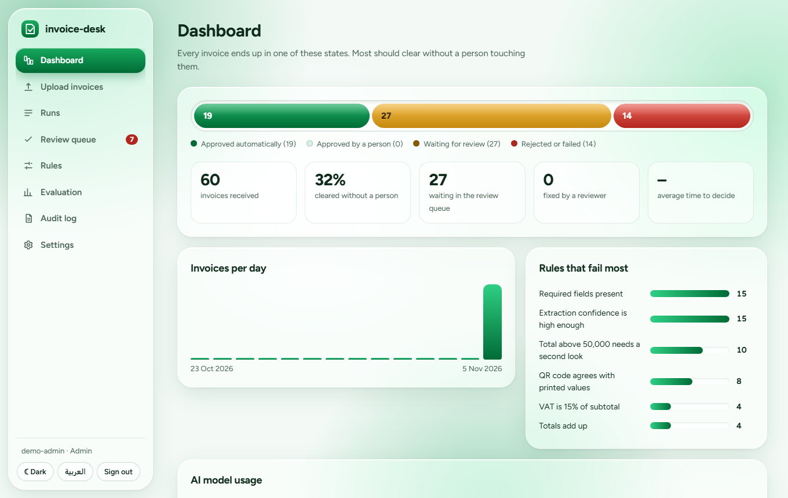
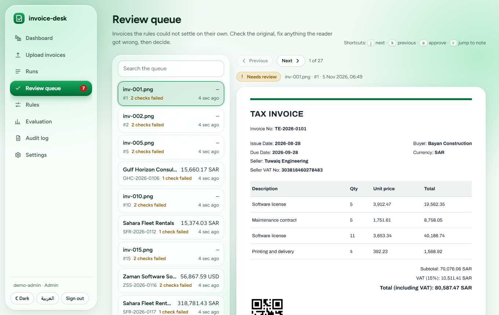
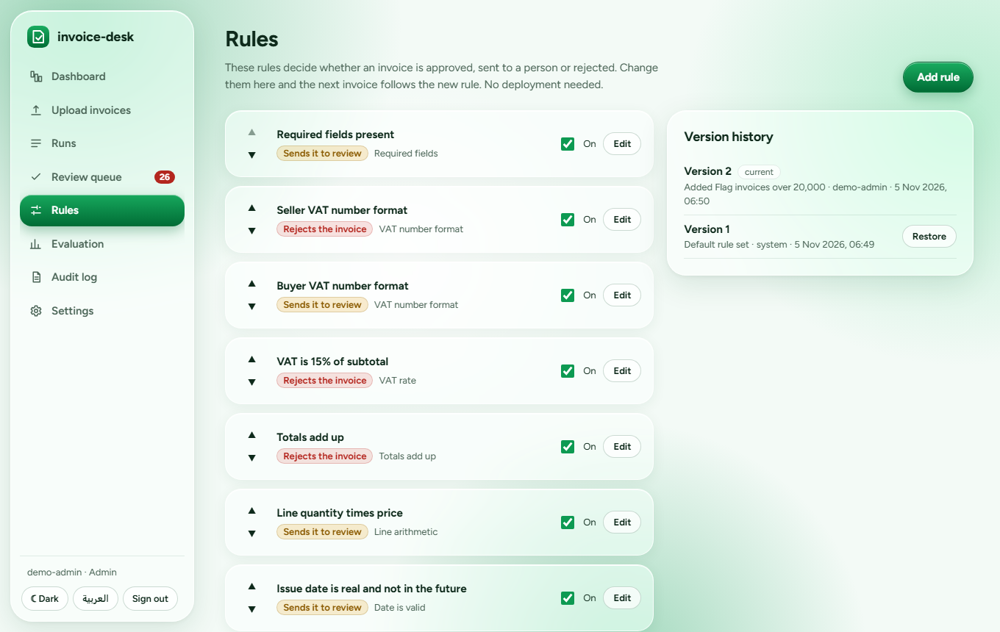
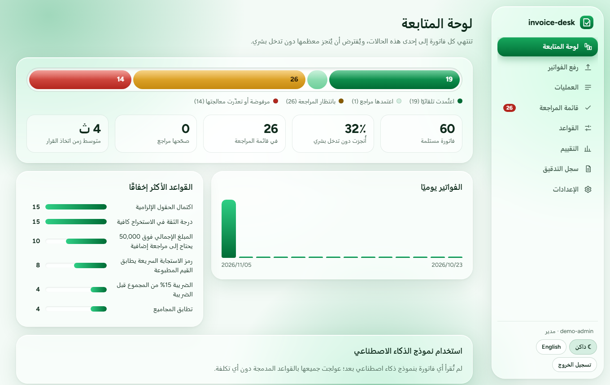
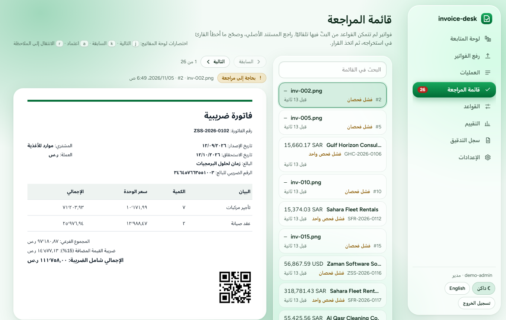
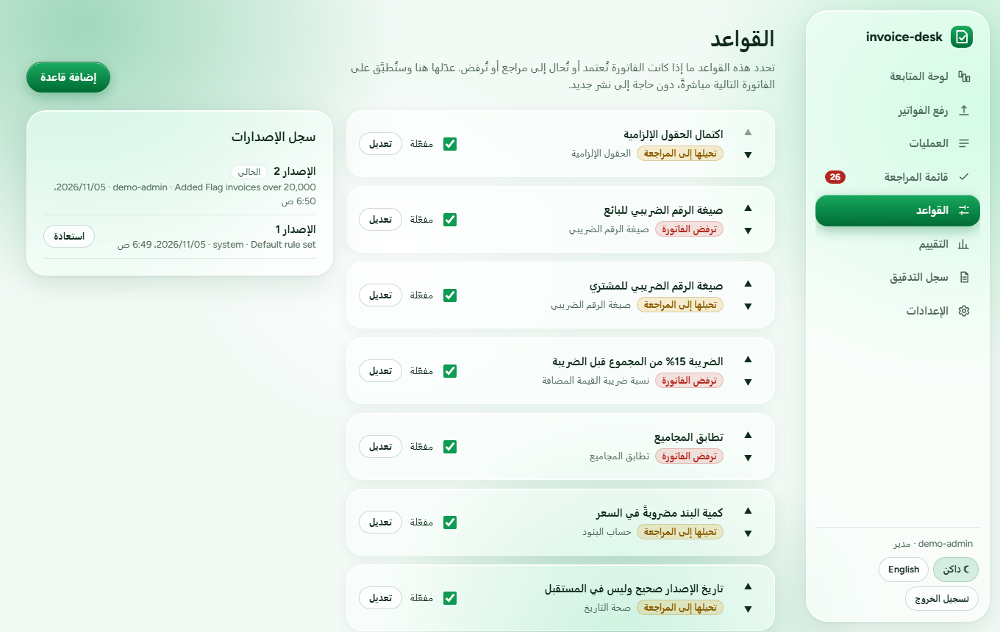
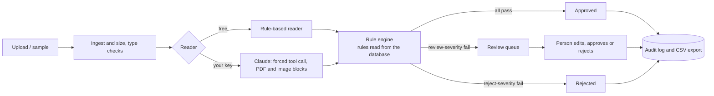

# invoice-desk

A Saudi e-invoice intake desk. Invoices come in as text, PDF or photo. A built-in reader, or an AI model you choose (free options included), pulls out the fields, a rule engine checks them, clean invoices are approved automatically, doubtful ones go to a person, and every decision is logged. The rules live in the database and are edited in the portal, so changing a policy needs no deployment.

**Live demo: https://invoice-desk-ct8w.onrender.com** (pick a role to look around; all data is made up). It runs on Render's free tier, so the first load after a quiet spell can take about a minute while the server wakes up, and its data resets whenever the server restarts.



| Review queue | Rules admin |
|---|---|
|  |  |

| Arabic dashboard | Arabic review queue | Arabic rules |
|---|---|---|
|  |  |  |

## What it does

- **Reads invoices** in English, Arabic or both, from text, PDFs and images. Two kinds of reader: a free built-in rule-based reader that needs nothing, and an AI model of your choice: **Google Gemini (free key)**, **Groq (free)**, **OpenRouter (free models)**, **Ollama (runs on your own computer)**, Anthropic Claude or OpenAI. All of them go through one extractor interface, with a guard against instructions hidden in the document.
- **Validates** with 14 rule types: required fields, Saudi VAT number format, 15% VAT, totals, line arithmetic, dates, currency, amount limits, QR code agreement (TLV payload), duplicates, extraction confidence, regex, and a custom expression type.
- **Routes** each invoice: approved automatically, sent to review, or rejected. Severity is set per rule.
- **Human review** queue: a searchable list of everything waiting, beside the original and its extracted fields. Edit anything, approve or reject with a note, and move through the queue with Previous/Next or the keyboard (`j` next, `k` previous, `a` approve, `r` jump to the note). Each invoice has its own link (`#/review/<id>`), and after a decision the next one opens. Corrections are kept next to the original extraction.
- **Rules as data**: add, edit, reorder, switch off and delete rules in the portal. Every change is a version you can restore. A dry run shows how many past invoices would get a different decision before you save.
- **Audit log** of every action, including automatic decisions.
- **Evaluation** page: scores the reader and rules on 60 synthetic invoices with a known answer key (field accuracy, decision agreement, unsafe approvals, false rejections).
- **Roles**: viewer, reviewer, admin. Signed tokens. Demo mode lets visitors pick a role; set `DEMO_MODE=0` and `INVOICE_DESK_USERS` for real sign-in.
- **Portal**: React and TypeScript, about 75 KB gzipped, no UI or chart library. A frosted-glass design in flag green and white, light and dark themes, responsive down to phone width.
- **Full Arabic** with a right-to-left layout: every screen is translated, with Arabic plural forms, and numbers and dates are formatted for the chosen language, while invoice numbers, VAT numbers, amounts and currency codes stay left-to-right. `node tools/check_i18n.mjs` (run in CI) fails if any text in the portal is missing its Arabic.
- **MCP server** so Claude Desktop or Claude Code can read and check invoices.

## Run it

On Windows, `docs/RUN_ON_WINDOWS.md` has the click-by-click version.

Needs Python 3.11+. The built portal is included, so Node is not required to try it.

```bash
pip install -e "."
uvicorn invoice_desk.api:app --port 8000
# open http://localhost:8000 and pick a role
```

Docker: `docker compose up --build`, then open http://localhost:7860.

Portal development: `cd web && npm install && npm run dev` (proxies `/api` to port 8000). Rebuild with `npm run build`.

### Using an AI model (optional)

The default needs no key. To read images, scans and unusual layouts, open **Settings**, pick a provider, paste its key and press **Save and test connection**.

| Provider | Cost | Reads images | Where to get a key |
|---|---|---|---|
| Google Gemini | Free tier, no card | Yes, and PDFs | aistudio.google.com/apikey |
| Groq | Free plan, rate limited | No (text and text-layer PDFs) | console.groq.com/keys |
| OpenRouter | Has free models (id ends in `:free`) | No | openrouter.ai/keys |
| Ollama | Free, runs locally | With a vision model | ollama.com (set `INVOICE_DESK_ALLOW_LOCAL=1`) |
| Anthropic Claude | Paid API key (a Claude Pro chat plan does not include API credits) | Yes, and PDFs | console.anthropic.com |
| OpenAI | Paid | Yes | platform.openai.com |

The key stays in the browser tab's session storage, travels in a request header to this server, is used for that request and is not stored or logged (there are tests for that). Free tiers have rate limits, and Google may use free-tier content to improve its products, so use only made-up invoices. If an AI call fails, the invoice falls back to the built-in reader and the trace says so. Model names are editable because providers rename them.

The provider adapters are tested against a fake HTTP server (request shape, error messages, fenced JSON, retry without JSON mode). They have not been run against the live services from the build environment, so press **Save and test connection** once with your own key.

## Measured results (rule-based reader, no key)

60 synthetic invoices, answer key generated alongside them, `python -m invoice_desk.evaluation`:

| | Invoices | Right decision | Fields correct |
|---|---|---|---|
| All | 60 | 80% | 81% |
| Text | 40 | 90% | 92% |
| PDF with a text layer | 10 | 100% | 100% |
| Image | 10 | 20% | 13% |
| Unusual wording ("Billed on", "Amount payable") | 4 | 0% | 25% |

Unsafe auto-approvals: 0. Wrongly rejected: 0. When the rule-based reader cannot read something, the invoice goes to a person, it is not guessed at.

**Read these numbers carefully.** The invoices are synthetic and follow formats the rule-based reader was written against, so its text and PDF scores are optimistic. The image and unusual-wording rows are the honest weak spot, and they are where a language model is supposed to help. No AI-model run is included in these numbers. Run the Evaluation page with Gemini's free key and compare. Do not quote AI accuracy figures until you have.

## Architecture



- `src/invoice_desk/rules.py`: rule types, a hand-written evaluator for custom expressions (an allowlist of AST nodes and helper functions: no attribute access, imports, calls to anything else, or exponentiation).
- `desk.py`: pipeline, review flow, versioned rules, simulation, stats. No HTTP in it.
- `extractors.py` and `providers.py`: the readers. `qr.py`: ZATCA-style TLV QR encode and decode. `textnorm.py`: Arabic-Indic digits, separators, dates.
- `api.py`: FastAPI, roles, rate limit, upload validation (type, 5 MB, 20 files). OpenAPI docs at `/docs`.
- `web/`: the portal. `tools/generate_data.py` builds the sample set; `tools/e2e.py` is a browser walk-through that also produces the screenshots.

## Tests

```bash
pip install -e ".[dev,mcp]"
pytest -q          # 98 tests: rules, expression safety, pipeline, review and the review queue, versioning, API roles, provider adapters (fake servers), evaluation
python tools/e2e.py   # with the server running: drives the portal in Chromium
```

## Limits, stated plainly

- Not ZATCA-certified and not connected to Fatoora. It applies publicly documented rules (VAT number shape, 15% VAT, TLV QR tags 1 to 5) and is not tax or compliance software.
- All sample data is invented, including company names and VAT numbers. Do not upload real invoices to a public demo.
- AI providers are tested against fakes only. Their accuracy is yours to measure.
- Data is held in SQLite. On free hosting without a volume it resets when the container restarts.
- The Arabic interface translates everything the portal itself writes. Invoice contents, rule names an admin types, check details and server error messages are shown as written, usually in English.

## Licence

MIT.
