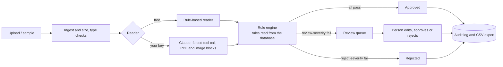

# invoice-desk

A Saudi e-invoice intake desk. Invoices come in as text, PDF or photo. A built-in reader, or an AI model you choose (free options included), pulls out the fields, a rule engine checks them, clean invoices are approved automatically, doubtful ones go to a person, and every decision is logged. The rules live in the database and are edited in the portal, so changing a policy needs no deployment.

**Live demo: https://invoice-desk-ct8w.onrender.com** (pick a role to look around; all data is made up). It runs on Render's free tier, so the first load after a quiet spell can take about a minute while the server wakes up, and its data resets whenever the server restarts.


| Review queue | Rules admin |
|---|---|
|  |  |

| Arabic dashboard | Arabic review queue | Arabic rules |
|---|---|---|
|  |  |  |

## What it does

- **Reads invoices** in English, Arabic or both, from text, PDFs, images and UBL 2.1 XML (read directly, no AI). Two kinds of reader: a free built-in rule-based reader that needs nothing, and an AI model of your choice: **Google Gemini (free key)**, **Groq (free)**, **OpenRouter (free models)**, **Ollama (runs on your own computer)**, Anthropic Claude or OpenAI. All of them go through one extractor interface, with a guard against instructions hidden in the document.
- **Validates** with 20 rule types, including checks against ZATCA e-invoicing fields: required fields, Saudi VAT number format, 15% VAT (zero-rated and exempt lines carry none), totals, line arithmetic, dates (Gregorian or Hijri), currency, amount limits, QR code present and in agreement (TLV payload), duplicates, extraction confidence, regex, a custom expression type, and five checks against your vendor master and purchase orders (below).
- **Routes** each invoice: approved automatically, sent to review, or rejected. Severity is set per rule.
- **Human review** queue: a searchable list of everything waiting, beside the original and its extracted fields. Edit anything, approve or reject with a note, and move through the queue with Previous/Next or the keyboard (`j` next, `k` previous, `a` approve, `r` jump to the note). Each invoice has its own link (`#/review/<id>`), and after a decision the next one opens. Corrections are kept next to the original extraction.
- **Review copilot**: an "Investigate" button on each invoice in review. It looks up the vendor, the vendor's earlier invoices and IBANs, the purchase order and similar earlier invoices, then suggests approve, reject or find out more, with the evidence and every step it took. It only suggests: it has no way to approve or reject, and a person decides. The rule-based mode needs no key; with a Google Gemini key, Gemini can choose the lookups itself (tool calling, at most 8 per invoice, read-only tools, key sent per request and never stored). Every step is in the audit log as `agent:rules` or `agent:gemini`. On the synthetic samples the rule-based copilot's suggestion matches the right decision on 25 of the 41 items the built-in reader sends to review, with no approve suggestion where approving would be wrong; the rest are mostly images it cannot read, where it asks for more.
- **Rules as data**: add, edit, reorder, switch off and delete rules in the portal. Every change is a version you can restore. A dry run shows how many past invoices would get a different decision before you save.
- **Vendor master and purchase orders**: a Vendors page to list, add, edit, delete and import vendors and POs from CSV, with name matching across English and Arabic and a one-click "Link to vendor" in review.
- **Demo start**: on an empty database the dashboard offers "Load sample invoices" or "Try with your own AI key". The samples are read by the built-in reader: a welcome set of 20 over the last 7 days (11 approved, 6 to review, 3 rejected) and a history of 54 more over the last 30 days, where the ones that went to review were decided by two made-up reviewers. All of it is synthetic and dated by the loader, so the charts have something to show. Each run is tagged as an upload or an evaluation run; the dashboard and Runs show uploads by default, the duplicate check only compares runs from the same source, and evaluation runs never enter the review queue. Admins reset the demo from Settings after a confirm step.
- **Dashboard**: a greeting with what needs a person today, figures for today or the last 7, 30 or 90 days with the change against the period before (amounts in SAR; other currencies are counted, not converted), invoices per day (per hour for today) by outcome, the oldest invoices waiting for review, and recent activity in plain words.
- **Audit log** of every action, including automatic decisions.
- **Evaluation** page: scores the reader and rules on 92 synthetic invoices with a known answer key (field accuracy, decision agreement, unsafe approvals, false rejections).
- **Roles**: viewer, reviewer, admin. Signed tokens. Demo mode lets visitors pick a role; set `DEMO_MODE=0` and `INVOICE_DESK_USERS` for real sign-in.
- **Portal**: React and TypeScript, about 100 KB gzipped (script and styles), no UI or chart library. Solid surfaces in a calm green, one set of status colours (green approved, amber review, red rejected, dark red high risk), IBM Plex Sans with IBM Plex Sans Arabic served from the app, tabular figures, light and dark themes, responsive down to phone width. The review screen puts the original beside the reasons and fields, failed checks first, with Approve and Reject always on screen.
- **Full Arabic** with a right-to-left layout: every screen is translated, with Arabic plural forms, and numbers and dates are formatted for the chosen language, while invoice numbers, VAT numbers, amounts and currency codes stay left-to-right. The reasons under failed checks are translated too. `node tools/check_i18n.mjs` (run in CI) fails if any text in the portal is missing its Arabic.
- **MCP server** so Claude Desktop or Claude Code can read and check invoices.

## What is checked, and what is not

| Checked | Not checked |
|---|---|
| ZATCA e-invoice fields: VAT number shape, 15% VAT on standard-rated lines, totals and line arithmetic, Gregorian and Hijri dates, currency | Cryptographic signature, certificate, invoice hash chain (PIH), cryptographic stamp, invoice counters, full UBL schema and business rules |
| QR code: the TLV tags 1 to 5 (seller, VAT number, time stamp, total, VAT) compared with the printed invoice | QR tags 6 to 9; no clearance or reporting, nothing is submitted to Fatoora |
| Your vendor master: known vendor, blocked vendor, VAT number and IBAN against what you hold, IBAN shape and mod-97 check digits, purchase order amount | No bank verification of the account, and no live VAT number or vendor lookup with ZATCA or anyone else |

Details are in the two sections further down.

## Run it

On Windows, `docs/RUN_ON_WINDOWS.md` has the click-by-click version.

Needs Python 3.11+. The built portal is included, so Node is not required to try it.

```bash
pip install -e "."
uvicorn invoice_desk.api:app --port 8000
# open http://localhost:8000 and pick a role
```

Docker: `docker compose up --build`, then open http://localhost:7860.

Portal development: `cd web && npm install && npm run dev` (proxies `/api` to port 8000). Rebuild with `npm run build`.

### Using an AI model (optional)

The default needs no key. To read images, scans and unusual layouts, open **Settings**, pick a provider, paste its key and press **Save and test connection**.

| Provider | Cost | Reads images | Where to get a key |
|---|---|---|---|
| Google Gemini | Free tier, no card | Yes, and PDFs | aistudio.google.com/apikey |
| Groq | Free plan, rate limited | No (text and text-layer PDFs) | console.groq.com/keys |
| OpenRouter | Has free models (id ends in `:free`) | No | openrouter.ai/keys |
| Ollama | Free, runs locally | With a vision model | ollama.com (set `INVOICE_DESK_ALLOW_LOCAL=1`) |
| Anthropic Claude | Paid API key (a Claude Pro chat plan does not include API credits) | Yes, and PDFs | console.anthropic.com |
| OpenAI | Paid | Yes | platform.openai.com |

The key stays in the browser tab's session storage, travels in a request header to this server, is used for that request and is not stored or logged (there are tests for that). Free tiers have rate limits, and Google may use free-tier content to improve its products, so use only made-up invoices. If an AI call fails during normal intake, the invoice falls back to the built-in reader and the trace says so.

**Model names.** Providers rename and retire models, and a name that works for an older key can be refused for a new one, so the **Model** box in Settings is always editable and no default is guaranteed. Gemini starts with `gemini-3.5-flash-lite`; `gemini-3.8-flash` is suggested as an alternative to try. If Gemini answers that a model isn't available, the message asks you to type a current model name, as listed at aistudio.google.com. (`gemini-2.5-flash` and `gemini-2.5-flash-lite` are refused for new free keys.)

The provider adapters are tested against a fake HTTP server (request shape, error messages, fenced JSON, retry without JSON mode). They have not been run against the live services from the build environment, so press **Save and test connection** once with your own key.

## Checks against ZATCA e-invoicing fields

What is checked, with the default rules:
- **VAT registration numbers**: 15 digits, starting and ending with 3, in Western or Arabic-Indic digits, grouped with spaces or not. A missing seller VAT number sends the invoice to review; a malformed one rejects it.
- **VAT amounts**: VAT equals 15% (configurable, with a small rounding tolerance) of the standard-rated amount. Lines marked zero-rated (Z), exempt (E) or out of scope (O) carry no VAT. Subtotal plus VAT must equal the total.
- **Currency and numbers**: SAR is the expected currency and is assumed when none is printed (with a note). Arabic-Indic digits and the Arabic decimal and thousands separators are read before any check.
- **Dates**: Gregorian or Hijri. Hijri dates (1420 to 1500 AH) are converted to Gregorian with the Umm al-Qura calendar, from a table generated offline out of the ICU data in Node (`tools/build_hijri_table.mjs`). Future-dated invoices go to review.
- **QR code**: the base64 TLV payload (seller name, VAT number, time stamp, total, VAT amount) is read from the printed text, from UBL XML, or from the QR image in a PDF or picture, and compared with the invoice, including the time stamp's date in Saudi time. A mismatch goes to review; no QR code at all is a warning only (the rule can be limited to simplified tax invoices).
- **UBL 2.1 XML**: uploaded XML invoices are read directly into the same fields and checked by the same rules. XML with any DOCTYPE or ENTITY declaration is refused, so external entities cannot be used. Reviewers see an XML invoice laid out as an invoice (seller and buyer, lines, totals, IBAN, PO and QR code, in English or Arabic); the source XML is one click away for technical users.

What is not checked: cryptographic signatures, the certificate, the invoice hash chain (PIH), the cryptographic stamp and the later QR tags (6 to 9), invoice counters, and the full UBL schema and business rules. Nothing is submitted to Fatoora (clearance or reporting). The QR image reader handles clean, digitally made codes, upright or turned by a right angle; a phone photo taken at an angle may not be readable. It is a small reader written for this project, which checks every read by re-encoding it with the `qrcode` package; it does not do error correction.

## Vendor master and purchase orders

The Vendors page holds who you buy from: English and Arabic name, VAT number, IBAN, default currency, and whether the
vendor is approved or blocked. Purchase orders (PO number, vendor, amount, currency, open or closed) are imported from
CSV. The demo starts with sample vendors and POs; a fresh or reset database gets them, an existing database keeps its
own rules and vendors.

Five rules use them, each with English and Arabic labels, versioning, dry run and rollback like every other rule:

| Rule | When it fails | Default |
|---|---|---|
| Vendor is in the vendor master | the seller matches no vendor by name or VAT number | review |
| Vendor is not blocked | the matched vendor is blocked | reject |
| Seller VAT number matches | the VAT number differs from the one held for the vendor | review |
| IBAN matches | the IBAN on the invoice is invalid or differs from the vendor's | review, marked **high risk** |
| Within the purchase order | the invoice total is above its PO, beyond a tolerance (1% by default) | review |

They skip while the vendor master is empty, and each skips when the invoice lacks what it needs (a PO number, an IBAN).
A changed IBAN gets its own warning, because a changed bank account is a common fraud pattern: confirm it with the vendor
using contact details you already hold.

**Matching** is deterministic and has no AI call. A name is normalised (case, spacing, punctuation, Arabic diacritics and
tatweel, letter variants such as أ/إ/آ, ة/ه and ى/ي, the article ال, and legal words such as LLC, Co., شركة, مؤسسة and
ذ.م.م), then compared with each vendor's English name, Arabic name and any names a reviewer linked. Same words after
normalising score 1.0; otherwise the score is 0.6 times the word overlap plus 0.4 times the character similarity, and 0.85
is needed. "Al Rajhi Trading LLC" and "الراجحي للتجارة" meet through the vendor record, which holds both names; nothing is
transliterated. If no name is close enough, an exact VAT number match identifies the vendor. The run detail shows the
score, what it matched on and why, and the closest vendors with a "Link to vendor" button that remembers the name.

What is checked and what is not: the VAT number's shape, and the IBAN's shape (Saudi: 24 characters, SA then 22 digits)
and its mod-97 check digits. There is **no bank verification** (nobody confirms the account exists or belongs to the
vendor) and **no live vendor or VAT lookup** with ZATCA or anyone else. The vendor master is only as good as what you
put in it.

## Measured results

**These are regression figures, not real-world accuracy.** Every invoice is synthetic, generated by
`tools/generate_data.py`, and the answer key was written alongside them by the same author. They show the reader and
rules still do what they were built to do on this set; they say nothing about invoices from real suppliers.

### AI reader: Gemini 3.1 Flash Lite (free tier)

On the original 60 synthetic invoices (text, PDF and images, English and Arabic):

| | Result |
|---|---|
| Right decision | 60 of 60 |
| Fields correct | over 99% |
| Wrong approvals | 0 |

Run from the Evaluation page with a free Gemini key. It has not been run on the 32 invoices added since (ZATCA fields,
vendors and POs, and PDF copies of three demo samples).

### Rule-based reader (no key)

92 synthetic invoices (the original 60, 18 for the checks against ZATCA e-invoicing fields, 11 for the vendor master and POs, and PDF copies of three of those: the changed IBAN, the wrong VAT number and the QR code mismatch), answer key generated alongside them, `python -m invoice_desk.evaluation`:

| | Invoices | Right decision | Fields correct |
|---|---|---|---|
| All | 92 | 86% | 85% |
| Text | 57 | 93% | 95% |
| PDF with a text layer | 15 | 100% | 100% |
| UBL XML | 8 | 100% | 100% |
| Image | 12 | 25% | 12% |
| Unusual wording ("Billed on", "Amount payable") | 4 | 0% | 25% |

On the original 60 alone the figures are unchanged (80% decisions, 81% fields). The 18 for the ZATCA fields score 94% and 90%; the miss is an image, which the rule-based reader cannot read. The 11 vendor samples (a known vendor, a name written differently, a changed IBAN, a blocked vendor, an unknown vendor, a VAT number that differs, an invoice above its PO) score 100% and 100%; they are text and XML written for this reader. The three PDF copies (changed IBAN, wrong VAT number, QR code mismatch) score 100% and 100%.

Unsafe auto-approvals: 0. Wrongly rejected: 0. When the rule-based reader cannot read something, the invoice goes to a person, it is not guessed at.

**Read these numbers carefully.** The invoices are synthetic and follow formats the rule-based reader was written against, so its text and PDF scores are optimistic. The image and unusual-wording rows are the honest weak spot, and they are where a language model helps: the Gemini run above reached the right decision on every one of the original 60, images included. To measure a model yourself, run the Evaluation page with your own key.

### Evaluating an AI model on a free tier

Gemini's free tier allows only about 5 to 10 requests a minute and around 20 a day per model, so all 92 invoices cannot be read in one go. The Evaluation page handles that:

- **A sample, not all 92.** Choose how many invoices (default 20). The pick is stratified: it always includes every file type, every language, a duplicate and the prompt-injection sample, then as many kinds of check as fit (18 of the 28 at 20, all of them from 30), and fills the rest in proportion to the full set. The same seed gives the same invoices. UBL XML in the sample is read directly, so it costs no AI requests.
- **Continue tomorrow.** Tick *Only invoices not yet evaluated with this model* and the next run picks from what is left. Results are stored per provider and model with the date, and the page shows combined totals over everything evaluated so far, with the sample size *n* next to every percentage.
- **Paced.** *Requests per minute* (default 4) spaces the calls. A 429 or 503 is retried up to 3 times, honouring `Retry-After` (or Gemini's `retryDelay`) when given and backing off otherwise. A daily-quota answer stops the run at once with a clear message; what was done is kept.
- **No silent fallback.** During evaluation a failed AI call is never handed to the built-in reader. That invoice is recorded as an error, shown in the count ("14 of 20 evaluated, 6 errors") and left out of every percentage.

## Architecture



- `src/invoice_desk/rules.py`: rule types, a hand-written evaluator for custom expressions (an allowlist of AST nodes and helper functions: no attribute access, imports, calls to anything else, or exponentiation).
- `desk.py`: pipeline, review flow, versioned rules, simulation, stats. No HTTP in it.
- `extractors.py` and `providers.py`: the readers. `ubl.py`: UBL 2.1 XML. `qr.py`: ZATCA-style TLV QR encode and decode. `qrscan.py`: reading QR codes from images and PDF pages. `textnorm.py` and `hijri.py`: Arabic-Indic digits, separators, Gregorian and Hijri dates. `vendors.py`: name matching, IBAN checks and PO matching.
- `api.py`: FastAPI, roles, rate limit, upload validation (type, 5 MB, 20 files). OpenAPI docs at `/docs`.
- `web/`: the portal. `tools/generate_data.py` builds the sample set; `tools/e2e.py` is a browser walk-through that also produces the screenshots.

## Tests

```bash
pip install -e ".[dev,mcp]"
pytest -q          # 304 tests: rules and their edge cases, run sources and the demo start, vendor matching and IBANs, expression safety, pipeline, review and the review queue, versioning, API roles and input validation, provider adapters and 429/503 retries (fake servers), evaluation and the AI sample
python tools/e2e.py         # with the server running: drives the portal in Chromium and saves the screenshots
python tools/ui_check.py    # with a fresh server: behaviour checks (directions, badge, waking screen, error messages, uploads)
python tools/a11y_check.py  # with a fresh server and `npm ci` in web/: axe-core on every page in English/Arabic, light/dark, plus keyboard checks
```

## Limits, stated plainly

- It runs checks against ZATCA e-invoicing fields; it has no ZATCA approval and is not connected to Fatoora. It applies publicly documented rules (VAT number shape, 15% VAT, TLV QR tags 1 to 5) and is not tax software.
- Vendor checks compare the invoice with your own vendor master only. IBANs are checked for shape and check digits, not with a bank; no vendor or VAT number is looked up anywhere.
- All sample data is invented, including company names, VAT numbers and IBANs. Do not upload real invoices to a public demo.
- AI providers are tested against fakes only. Their accuracy is yours to measure.
- Data is held in SQLite. On free hosting without a volume it resets when the container restarts.
- The Arabic interface translates everything the portal itself writes, and the reasons the rules give. Invoice contents, rule names and messages an admin types, and server error messages are shown as written, usually in English.
- The measured results come from synthetic invoices with a self-written answer key. They are a regression test, not a measure of accuracy on real invoices.

## Licence

MIT.
